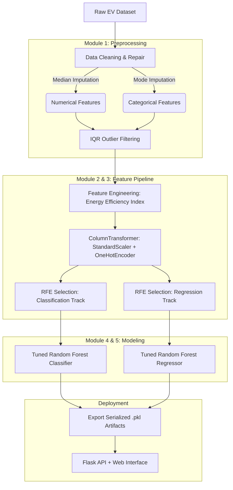
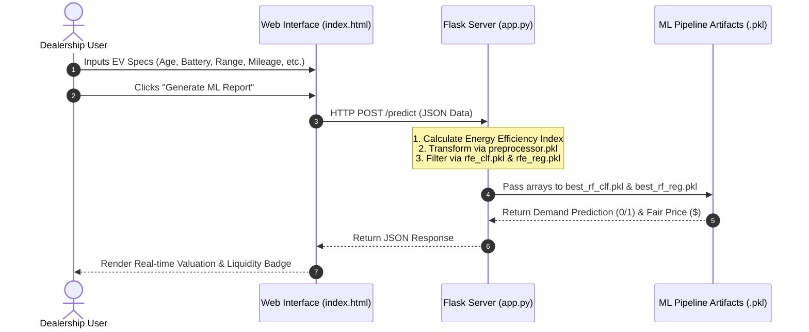

# Project EcoDrive: Used EV Market Intelligence & Valuation Engine

A machine learning application that solves two pricing and inventory challenges for pre-owned Electric Vehicles (EVs):

1. **Demand / Liquidity Prediction:** Predicts whether an incoming vehicle listing will sell rapidly (`High_Demand`: 1) or experience prolonged lot time (`High_Demand`: 0).
2. **Fair Price Valuation:** Forecasts the fair market resale price in USD (`Resale_Price_USD`).

Built using Python, Scikit-Learn, Flask, and Tailwind CSS.

## End-to-End Pipeline Workflow

The flowchart below illustrates data progression through the machine learning pipeline from raw dataset ingestion to API service deployment:



## System Architecture & Web Integration

The sequence diagram details interactions between the web client and trained models via the Flask REST API:



## Pipeline Modules & Model Performance

### 1. Data Cleaning & Outlier Removal
* **Null Imputation:** Applied median imputation for continuous variables (`Battery_Capacity_kWh`, `Odometer_km`) and mode imputation for categorical attributes (`Brand`, `Battery_Chemistry`).
* **Anomalies:** Utilized Interquartile Range (IQR) filtering ($Q1 - 1.5 \times IQR$ to $Q3 + 1.5 \times IQR$) to eliminate extreme typos and data entry errors (e.g., odometer values of $9,999,999 \text{ km}$).

### 2. Feature Engineering
Engineered a domain-specific metric, the **Energy Efficiency Index (EEI)**, to account for battery degradation over time:

$$
\text{EEI} = \left(\frac{\text{Max Range (km)}}{\text{Battery Capacity (kWh)}}\right) \times \left(1 - (\text{Vehicle Age (Years)} \times 0.02)\right)
$$

### 3. Feature Selection & Validation Strategy
* **Classification Track:** Evaluated using 5-fold Stratified K-Fold cross-validation alongside Recursive Feature Elimination (RFE) to preserve class balance.
* **Regression Track:** Evaluated using 5-fold Standard K-Fold cross-validation paired with RFE for continuous target optimization.

### 4. Model Benchmarking & Tuning Results

| Task | Baseline Models Evaluated | Best Model (Ensemble) | CV Score | Metric |
| :--- | :--- | :--- | :--- | :--- |
| **Market Liquidity** | Logistic Reg, KNN, SVM | **Tuned Random Forest Classifier** | **~85.4%** | Accuracy |
| **Resale Valuation** | Linear Reg, KNN Regressor, SVR | **Tuned Random Forest Regressor** | **± $2,150** | RMSE (USD) |

## Project Structure

```text
Project_EcoDrive/
│
├── major_project_project_ecodrive.py   # Complete ML training & .pkl export script
├── ecodrive_ev_dataset.csv             # Raw pre-owned EV dataset (500+ records)
├── app.py                              # Flask backend API server
├── requirements.txt                    # Python environment dependencies
├── README.md                           # Documentation
│
├── preprocessor.pkl                    # Saved Scaler + Encoder artifact
├── rfe_clf.pkl                         # Saved Classification Feature Selector
├── rfe_reg.pkl                         # Saved Regression Feature Selector
├── best_rf_clf.pkl                     # Tuned Random Forest Classifier
├── best_rf_reg.pkl                     # Tuned Random Forest Regressor
│
└── templates/
    └── index.html                      # Interactive web dashboard
```

## Quickstart Guide

### 1. Clone & Install Dependencies
```bash
git clone https://github.com/souravagr123/ecodrive-ml-pipeline.git
cd Project_EcoDrive
pip install -r requirements.txt
```

### 2. Train Models & Export Artifacts
Run the pipeline script once to clean data, train ensemble models, and export `.pkl` artifacts:
```bash
python major_project_project_ecodrive.py
```

### 3. Launch Application
Start the Flask web server:
```bash
python app.py
```
Access the application dashboard in your web browser at: `http://127.0.0.1:5000/`

## API Endpoint Reference

### `POST /predict`
* **Headers:** `Content-Type: application/json`
* **Request Payload:**
  ```json
  {
    "Brand": "Tesla",
    "Battery_Chemistry": "NCA",
    "Region": "West",
    "Vehicle_Age_Years": 3,
    "Battery_Capacity_kWh": 82.0,
    "Charging_Speed_kW": 250.0,
    "Max_Range_km": 500.0,
    "Odometer_km": 45000.0
  }
  ```
* **Response Payload:**
  ```json
  {
    "status": "success",
    "liquidity_prediction": 1,
    "price_prediction": 34850.50,
    "engineered_eei": 5.73
  }
  ```
